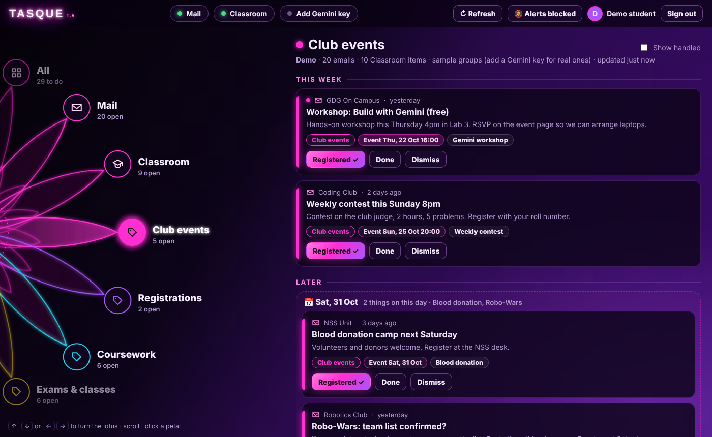

# Tasque_Manager1.5(CONSIDERING FEATURES TO ADD)

**Your Gmail and Google Classroom in one list, sorted by what's due.**
Gemini reads the subject lines, invents groups for them, and finds the event
and due dates hidden in the text. Things on the same day are clubbed together,
and a neon-pink lotus is the menu.



## What it does

- **Sign in with Google** (read-only) or **try the demo** with sample college mail.
- Loads your **last 20 emails** and your **latest Classroom posts** (assignments, announcements, and whether you've turned each one in).
- **Seven default categories** (*Club events, Registrations, Coursework, Exams & classes, Campus admin, Career, Low priority*), each with its own colour. Gemini puts items into these when they fit and only makes up a new category when nothing fits.
- **Sender check**: every email shows **✔ rvce.edu.in** if it's from a college address, **⚠ Not rvce.edu.in** if it isn't, and a red **⛔ Fake sender?** if it *claims* to be from the college but Gmail's own security check (SPF/DKIM/DMARC) failed. Change the trusted domain in `js/core/trust.js`.
- **📌 To do** (yellow button): pin anything you need to complete. It stays on the **To do** petal until you mark it done.
- **☆ Star**: keep an email for quick access on the **Starred** petal. The sender is saved under **Saved contacts** with Email and Copy buttons, so you can get back in touch later.
- **Read more**: open the full text of any email or announcement, so nothing is lost in the short preview.
- **Planner order**: Today → Tomorrow → This week → Later → No date → Past, using the *event* or *due* date, not the date the email arrived.
- **Same-day clubbing**: everything happening on one day sits in one box ("Sat 31 Oct · 2 things on this day · Robo-Wars, Blood donation").
- **History**: mark items *Registered*, *Done*, *Checked* or *Dismiss* them. They move to History, where you can undo. Assignments you turned in on Classroom show up there automatically.
- **Notifications**: checks for new things every 3 minutes, with a pop-up, a browser notification and a badge on the lotus.
- **The lotus**: the options sit on the petal tips of a half-hidden, rotating neon-pink lotus. Turn it with the **arrow keys**, the mouse wheel or a click.
- **Gemini key button** to add or change the key, like in Neon. Without a key, simple keyword rules do the grouping.

## Run it

No install, no build step.

```bash
python -m http.server 8000
```

Open <http://localhost:8000> and press **Try the demo**. In the demo, a "new"
Classroom post arrives after 20 seconds so you can see notifications.

To use your real account, follow **[SETUP.md](SETUP.md)** (about 10 minutes, once).

Requires set up of a Google Cloud Project connected to the mail you wish to login in with followed by enabling Gmail and Google classroom API and then creating a Client ID of type web application putting under javascript URI: http://localhost:8000 and finally copying the client ID which you should not share with anyone and paste into the request box when you sign up/in with your gmail

For Gemini grouping, get a free key at <https://aistudio.google.com/apikey> and
press **Add Gemini key**.

## Tests

```bash
node --test
```

Tests cover date finding ("this Friday 4pm", "24 Oct", "30/10"), the planner
order, same-day clubbing, stable group colours, the keyword rules and the demo data.

## Privacy

- **Read-only** Google permissions: Tasque can't send, delete or change anything.
- The Google token stays in this browser tab (`sessionStorage`) and goes only to Google.
- The Gemini key stays in this browser (`localStorage`) and goes only to Google's Gemini API.
- Only the subject, sender or class name, dates and a 200-character preview are sent to Gemini, never whole emails.
- A whole email is only downloaded when you press **Read more** on it, and it's only shown on your screen.
- There's no server. Everything runs in your browser.
- History, To do and Starred are saved in this browser only. They never reset on their own; use **🗑 Clear history** (in History) or clear the site's data. They don't sync between browsers or devices.

## How it's built

Plain HTML, CSS and JavaScript modules. See **[GUIDE.md](GUIDE.md)** for a tour of the code.

```
index.html, js/login.js     login page
app.html, js/app.js         the app: load → group → arrange → render → notify
js/ui/lotus.js              the SVG lotus menu
js/sources/                 google.js (sign-in), gmail.js, classroom.js, demo.js
js/ai/gemini.js             grouping with Gemini
js/core/                    dates, priority order, keyword rules, saved state (tested)
```

## Credits
-Built by Sonika Chandra with help from Claude (Anthropic) for code and explanations.
-Name and idea inspiration from a character in Toby Fox's Deltarune
## Licence

MIT. See [LICENSE](LICENSE).
